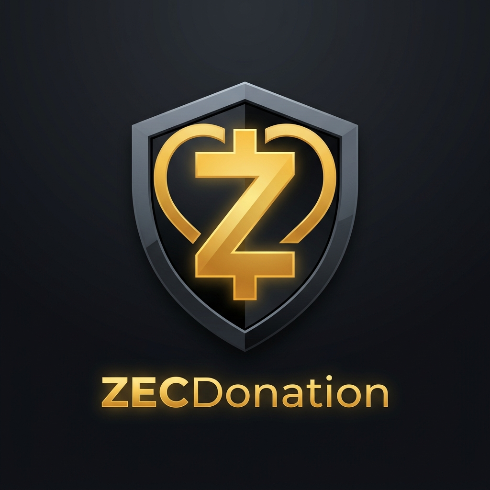

<p align="center">
  
</p>

<h1 align="center">ZECDonation</h1>

<p align="center">
  <strong>Privacy-First Zcash Crowdfunding & Shielded Donation Platform</strong>
</p>

<p align="center">
  <a href="#features">Features</a> &bull;
  <a href="#tech-stack">Tech Stack</a> &bull;
  <a href="#quick-start">Quick Start</a> &bull;
  <a href="#architecture-wallet-backend">Architecture</a>
</p>

---

A full-stack privacy-first donation platform built for the Zcash ecosystem. Create campaigns, generate ZIP-321 payment URIs with encrypted attribution memos, and leverage an automated escrow system that sweeps shielded funds to creators once targets are met!

## Features

- **Campaigns & Escrow** — Create fundraisers with custom titles, targets (ZEC), and deadlines. The platform automatically generates a unique escrow receiving address (`receive_ua`) for every campaign.
- **ZIP-321 Payments** — Donors are provided with standard Zcash ZIP-321 QR codes. Scanning the code in a compatible wallet automatically pre-fills the escrow address, the exact amount, and the `zd:<CODE>` attribution memo.
- **Sync Worker** — A background process continuously scans the wallet for incoming notes, parsing memos and matching them to campaigns.
- **Automated Payouts** — When a campaign hits its target or passes its deadline, the Payout Worker automatically sweeps the funds from escrow to the creator's designated `payout_ua`. It also handles "top-ups" for late donations!
- **Admin Dashboard** — View all your active campaigns, total escrow balance, and a feed of incoming transactions. Easily resolve unassigned notes manually.

## Tech Stack

| Layer | Technology |
|-------|------------|
| Backend | Node.js, Express, SQLite |
| Wallet Interface | Abstract `WalletBackend` (`mockBackend` and `zalletBackend`) |
| Frontend | React 18, Vite |
| Network | Zcash Testnet |

## Architecture: Wallet Backend

This platform is designed to interface with a Zcash wallet backend via JSON-RPC. Currently, it supports two modes configurable via the `.env` file:

1. **`mock`**: Runs entirely in memory using `src/wallet/mockBackend.js`. Useful for UI development and testing the Sync/Payout workers without waiting for blocks.
2. **`zallet`**: Connects to a Zcash/Zallet JSON-RPC node using `src/wallet/zalletBackend.js` (Requires a running node).

## Quick Start

### Prerequisites

- Node.js 18+

### Backend Setup

```bash
# 1. Install dependencies
npm install

# 2. Configure environment
cp .env.example .env
```

**Edit your `.env` file**:
```ini
# Choose 'mock' for local development or 'zallet' for real node integration
WALLET_BACKEND=mock

# Required if using 'zallet' backend:
ZALLET_RPC_URL=http://127.0.0.1:8232
ZALLET_RPC_USER=your_rpc_user
ZALLET_RPC_PASS=your_rpc_password
```

```bash
# 3. Start development server (auto-reload)
npm run dev
# The Sync Worker and Payout Worker will start automatically in the background.
```

Server runs at `http://localhost:3000`

### Frontend Setup

```bash
cd frontend
npm install
npm run dev
```

Frontend runs at `http://localhost:5173` (proxies `/api` to backend)

## Project Structure

```
ZECDonation/
├── src/
│   ├── server.js                 # Express app, routes, middleware
│   ├── database.js               # SQLite init + migrations
│   ├── sync.js                   # Background worker: fetches notes & attributes
│   ├── payout.js                 # Background worker: executes automated payouts
│   ├── campaign-service.js       # Campaign CRUD logic
│   ├── domain/                   # Business logic (memo parsing, zip321, base32)
│   └── wallet/                   
│       ├── WalletBackend.js      # Abstract interface
│       ├── mockBackend.js        # In-memory implementation
│       └── zalletBackend.js      # JSON-RPC implementation
├── frontend/
│   ├── src/
│   │   ├── api.js                # Fetch wrapper
│   │   ├── App.jsx               # Main React app
│   │   └── components/           # React components (Dashboard, CreateCampaign, DonatePage, etc)
├── .env.example
├── package.json
└── donations.db                  # SQLite database (auto-created)
```

## Security & Validation

All API inputs are strictly validated:
- **XSS Prevention**: Titles and descriptions strictly prohibit HTML (`<`, `>`).
- **Data Types**: Target amounts must be positive integers (`zatoshis`), deadlines must be future UNIX timestamps.
- **Address Validation**: `payout_ua` inputs are checked to ensure they are properly formatted Zcash addresses before being accepted.

## License

MIT